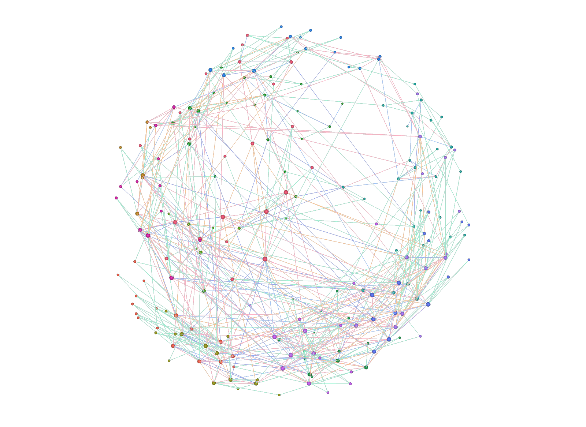
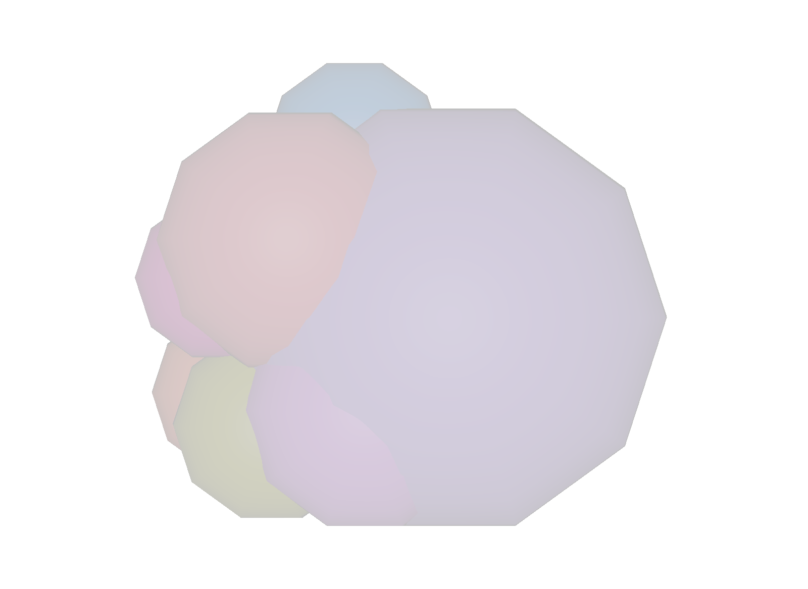
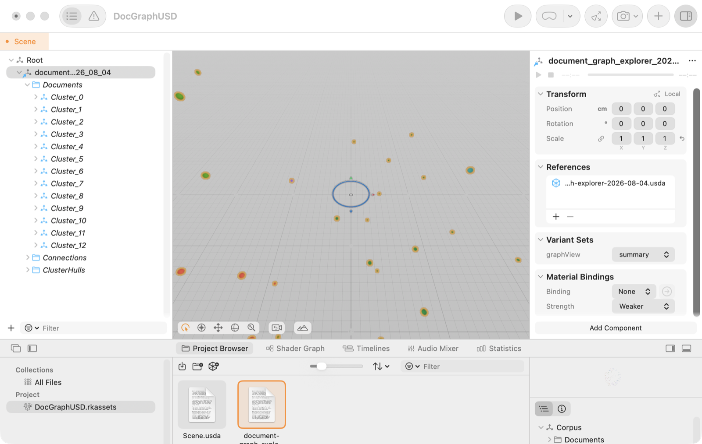

<div align="center">
  
  <h1>Resonance</h1>
  <p><strong>A private, local-first map of how your sounds and documents relate.</strong></p>
  <p>
    Drop in clips, loops or whole sample packs and get a graph of what sounds alike, shares a tempo or
    key, uses the same instruments, and mixes well together. Drop in PDFs, Markdown, Office files or a
    source repository and the same graph links them by topic, citation and meaning. Everything is
    analyzed in your browser; nothing is uploaded unless you turn on a cloud AI provider.
  </p>
  <p>
    <a href="https://document-graph-explorer.vercel.app"><strong>Try the live app</strong></a>
    · <a href="docs/user-guide.md">User guide</a>
    · <a href="docs/audio-analysis.md">Audio analysis in depth</a>
    · <a href="https://github.com/chrisatom1998/document-graph-explorer/releases/latest">Download a release</a>
    · <a href="SECURITY.md">Security model</a>
  </p>
  <p>
    <a href="https://github.com/chrisatom1998/document-graph-explorer/actions/workflows/ci.yml"></a>
    <a href="https://github.com/chrisatom1998/document-graph-explorer/releases/latest"></a>
    <a href="LICENSE"></a>
    <a href="package.json"></a>
    <a href="SECURITY.md"></a>
  </p>
</div>

> [!NOTE]
> This repository is still named **document-graph-explorer**, and packaged desktop builds and
> older releases carry the name **Document Graph Explorer**. The app itself, its installable web
> manifest and its exports now call themselves **Resonance**. Same project, one name going forward.

> [!IMPORTANT]
> **Your files stay on your device by default.** Decoding, tempo/key/instrument detection, parsing,
> OCR, embeddings, similarity, clustering, search and rendering all run client-side. The only ways
> data can leave the browser are ones you switch on: an OpenRouter key for document AI, a local
> Ollama server (stays on your machine), a collaboration session you start, a share link you copy, or
> the developer-only OpenAI sound assistant that exists solely under `npm run dev`. For an enforced
> guarantee rather than a toggle, `npm run build:airgap` produces a build whose browser policy permits
> no external hosts. [SECURITY.md](SECURITY.md) has the exact data-flow table.

## What it does

**For sounds.** Add a sample pack and every clip becomes a node. Resonance decodes each file
locally, estimates tempo, key (with Camelot code), genre and energy, finds mix points
(intro, build, drop, breakdown, outro), and tags what it hears: instruments, production type and
sound character from a 199-label DJ vocabulary. Clips are then linked by what they share, so you can
see at a glance which loops sound alike, which one-shots share an instrument, and which tracks will
mix in key and tempo.

**For documents.** Add a folder of notes, papers, contracts or a whole source repository. Resonance
parses the text, works out topics, names and places, and semantic similarity with a self-hosted
embedding model, follows cross-references and code imports, and groups the result into named
clusters. Click any node to read it, search by meaning, ask questions, and trace why two documents
are connected.

**Both at once.** Sounds and documents live in the same graph and the same saved workspace, so a
sample library and the notes about it can sit side by side.

| Capability | What you get |
| --- | --- |
| **Local audio intelligence** | FFmpeg decoding, Essentia tempo and key, bundled tempo and key networks, AudioSet AST instruments, MTG-Jamendo, a music-trained CLAP encoder and a trained sound tagger, all run on your device. Details in [docs/audio-analysis.md](docs/audio-analysis.md). |
| **Relationship types** | Instruments, sound properties, sounds alike, tempo, key, versions (same recording or another version of the song), same genre, shared title, similar meaning, keywords, names and places, and explicit links. Each one can be switched on or off in the filter sidebar. |
| **Explain every link** | Pick a clip or document and the inspector lists why each neighbour is connected, with a strength bar for every piece of evidence. |
| **Sample assistant** | Filter your library by label, BPM range, length and confirmed tags; find similar sounds; audition them; build and export crates; correct tags with the sound-category picker. |
| **Document readers and search** | PDF, Markdown, HTML, CSV, JSON, YAML, code and plain-text readers with passage highlighting; ⌘K search by meaning and title; side-by-side compare; shortest path between two documents. |
| **Insights and change tracking** | Orphans, possible duplicates, bridge and hub documents, stale files; named snapshots with visual compare; notes, tags and pins on any node. |
| **Chat** | Ask about your library. Answers come from your own passages and sample labels by default, with optional OpenRouter or Ollama models for richer replies. |
| **Workspaces** | Multiple named corpora saved in the browser, a watched folder that keeps the graph in sync while the app is open, and a saved library that skips unchanged files on re-import. |
| **Export and share** | Rekordbox collection XML, PNG, graph JSON backup and restore, a sanitized share link, and an OpenUSD scene for 3D tools. |
| **Runs anywhere** | Static web app, local launcher, Electron desktop app for macOS, Windows and Linux, runtime offline mode, or a sealed air-gapped build. |

## The workspace

Once a graph is ready, the screen has four parts:

- **Top bar.** The **Graph**, **Library** and **Export** tabs; search; a 2D/3D toggle; the
  **Sample assistant** (shown once audio is loaded); **Ask about your library** chat; and a
  **More tools** menu with Insights, Find a path, Snapshots, Saved views, Collaborate, Settings
  and Help.
- **Left sidebar.** Import buttons, then filters: similarity type, tempo range, key, genre, loop or
  one-shot, part (drums, bass, vocals, melody), detected sounds, file type, and advanced filters for
  cluster, minimum connections, link strength and recency.
- **Graph.** A force-directed map. A fresh profile starts in 2D; switch to 3D from the top bar. Drag
  to orbit, scroll to zoom, click a node to select it, press Home to fit everything.
- **Right inspector.** The selected clip or document, an inline player for audio, its connected
  neighbours one at a time with **Why they're connected**, and **Full details** for the complete
  panel: playback, tempo and key, mix points, versions, sounds, mix-with candidates, instrument
  evidence with **Listen at** buttons, manual track links, notes and tags, and for documents the
  reader, summary, topics, connections and Ask AI.

The **Library** tab is a keyboard-driven list of everything in the graph. The **Export** tab holds
every export and import action.

## Quick start

### Try it in the browser

Open the **[live app](https://document-graph-explorer.vercel.app)** and choose **Load demo corpus**
to explore immediately, or **Add files** / **Add a folder** to use your own. Processing happens in
that browser tab; adding files does not upload them to the host. Workspaces, notes and tags are saved
locally and reopen after a reload.

### Run it locally

```bash
npm install      # install dependencies
npm run dev      # start the Vite dev server at http://localhost:5173
```

Node 24 is the supported runtime (`.nvmrc`); Node 22.13 or newer also works, except Node 23, which
the locked dependencies do not support. The first
`npm run dev` or `npm run build` needs network access: a pre-script downloads about 632 MB of
checksum-verified audio-model weights from Hugging Face into `public/` (not stored in Git). Later
runs reuse the local files. Run `npm run setup:music` once while online to work offline afterwards.

Open the printed URL, then drag clips, sample packs, documents or folders onto the window. Whole
source repositories are supported and `.gitignore` rules are honoured.

### Use a packaged build

Download the latest artifacts from
[GitHub Releases](https://github.com/chrisatom1998/document-graph-explorer/releases/latest), or build
a target yourself with the commands under [Builds](#builds). Published releases can trail `main`; the
live app and the current source tree have the newest changes. Use `npm run build:airgap` when the
distribution must enforce zero external destinations.

## Working with sounds

**Add and play.** Add audio with **Add files**, **Import a folder** or drag and drop. Select a clip to
play it in the inspector; **Prepare playback** converts formats your browser cannot play, using the
bundled FFmpeg decoder on your device.

**Analysis.** New audio is analyzed during import, with a background status card you can minimize or
stop. **Settings → Music analysis mode** chooses between **Full — whole track** and
**Quick → Full in background**, which shows early estimates and then verifies the whole track.
Reanalyze a single track from **Full details → Track actions**, or a whole library from
**Settings → Data** (**Update older tracks**, **Re-analyze all tracks**).

**What the track panel shows.** Length; tempo and key, marking values that came from the file or
folder name and showing the audio estimate when it differs; genre and energy; mix points with
play-from buttons; same recording and other versions of the song; detected sounds marked likely,
maybe or possible; compatible tracks to mix with; and, under technical details, each model's guesses,
scan coverage and **Listen at** buttons that jump to the strongest passage for each instrument.

**Name clues win.** Tags in file or folder names such as `Dm`, `140bpm`, `Dm_140` or `Synths` take
precedence over audio estimates, and confirmed labels take precedence over both. The evidence always
says which source a value came from.

**Sample assistant.** Opens from the top bar once audio is loaded. **My library** filters by labels
or filename phrases, BPM range, maximum length and confirmed labels; **Find similar sounds** compares
labels, tempo and key (not waveforms); results can be auditioned, added to a crate, or corrected with
**More → Correct tags**. **Your crate** collects picks and **Export crate** downloads them as an
importable graph subset (no audio files). **Upload overview** summarizes what came in and groups it.

**Developer-only AI for sounds.** Under `npm run dev` with an `OPENAI_API_KEY` in a local `.env`,
the dev server adds natural-language library search, an AI crate builder, **Copilot review** of up
to five sounds, vocal transcription, upload summaries, voice input and an AI search for free sample
packs. The key stays in the Node process, and none of this ships in `npm run build`, the desktop apps
or the air-gapped build, where the local filters, similarity search, crates and tag correction keep
working. See [docs/dj-sample-assistant.md](docs/dj-sample-assistant.md) and
[docs/music-copilot-integration.md](docs/music-copilot-integration.md).

**Rekordbox.** **Export → Export for Rekordbox (XML)** writes a Rekordbox collection with each
track's BPM, key, Camelot code and sound tags in one playlist named "Resonance". The browser only
knows folder names, so the dialog asks where each imported folder lives on disk. No beat-grid markers
are written; Rekordbox draws its own. In Rekordbox, point **Preferences → Advanced → Database →
rekordbox xml** at the file and import the playlist from the rekordbox xml tree. Serato has no import
file for BPM or key, so there is no Serato export.

The full model list, thresholds and limits are in [docs/audio-analysis.md](docs/audio-analysis.md).

## Working with documents

- **Read.** Click a node, then **Full details**, for the document reader with passage highlighting,
  an **Open** button for the original file, summary, topics, names and places, and connections with
  evidence.
- **Search.** Press ⌘K or Ctrl+K to search by meaning and title. **Show all in graph** frames every
  match; Alt+Enter finds documents similar to a result.
- **Compare and trace.** **Compare** opens two documents side by side with shared topics, names and
  keywords highlighted. **More tools → Find a path** shows the fewest-hop route between any two
  documents, with the evidence for each hop.
- **Insights.** **More tools → Insights** lists pinned, unlinked, possibly duplicate, bridge, hub and
  stale documents plus cluster membership. A **What we found** card appears after every ingest.
- **Snapshots.** Save named graph states, reload them, and **Compare** paints added and updated
  documents on the live graph and lists what was removed.
- **Notes, tags and pins.** Every node takes free-text notes, tags and a pin. Search covers them.
- **Chat.** **Ask about your library** answers from the most relevant passages, or from all documents,
  with clickable citations that scroll the reader to the passage. Transcripts export to Markdown.
- **Optional AI.** **Settings → AI connections** adds an OpenRouter key (cloud) or a local Ollama
  server for summaries, topics, cluster names, per-document questions and richer chat. Off by
  default; core ingestion and graph intelligence never need it.
- **Repositories.** Drop a source tree: `.gitignore` is honoured, generated and vendor directories
  are skipped, symbols are extracted, and relative imports and includes become reference edges.
- **Watched folders and corpora.** The corpus switcher creates and renames named corpora and
  connects a watched folder so additions, edits and deletions stay in sync while the app is open.
- **Collaboration.** **More tools → Collaborate** starts or joins a session that shares selection,
  camera and filters over WebRTC. Notes and tags sync only if you opt in; document text never
  leaves your browser.

## Supported files

| Kind | Formats |
| --- | --- |
| **Audio** | MP3, WAV, FLAC, AIFF, Ogg, Opus, M4A, AAC, WMA, WebM, AMR, AU, AC3, DTS, APE, WavPack, CAF, ALAC, MKA, DSF and other containers; any `audio/*` type the browser reports. |
| **Documents** | Plain text, Markdown, PDF (with link annotations; scanned pages fall back to bundled Tesseract OCR), HTML, DOCX, PPTX, XLSX, EPUB, RTF, OpenDocument text, spreadsheets, presentations and drawings. |
| **Data** | CSV, TSV, JSON, JSON Lines, GeoJSON, YAML, Jupyter notebooks. |
| **Code** | About 120 languages by extension or filename, including TypeScript, JavaScript, Python, Go, Rust, C and C++, C#, Java, Kotlin, Swift, Ruby, PHP, shell, SQL, CSS, TOML, Dockerfile and Makefile. |

Unknown non-binary files are treated as text. Files are capped at 64 MB each.

## Export, import and sharing

All of these live on the **Export** tab.

| Action | What it produces |
| --- | --- |
| **Export image PNG** | The current scene as an image. |
| **Export for Rekordbox (XML)** | A Rekordbox collection with BPM, key and sound tags (audio only). |
| **Copy shareable URL** | A link whose fragment carries titles, summaries, topics, entities, clusters and connection evidence. It excludes full text, original bytes, local paths, embeddings, handles and settings, and shows a confirmation listing exactly that before copying. |
| **Export graph JSON** / **Copy graph JSON** | A backup of the graph: nodes, links, clusters, summaries, notes, tags and audio analysis, with document embeddings optional under Settings → Advanced. It omits full text and original files, so an imported graph reads and searches at reduced fidelity; keep the originals. |
| **Import graph JSON** | Restore a backup or open a crate someone exported. Also available as **Import a graph** on the welcome screen. |
| **Export 3D scene (USD)** | One self-contained `.usda` stage with documents as prims, relationships as curves, cluster hulls, a `docGraph:` attribute schema and a `graphView` variant set, openable in `usdview`, NVIDIA Omniverse and Apple Reality Composer Pro. |

| Pixar Storm (`usdrecord`), detailed view | Pixar Storm, `summary` variant | Apple Reality Composer Pro |
| --- | --- | --- |
|  |  |  |

The OpenUSD path has a companion Python CLI that validates and packages exported stages, and an
LLM agent that answers questions about a stage by querying it. Both are documented in
[docs/openusd-pipeline.md](docs/openusd-pipeline.md).

## How it works

Ingestion is an off-main-thread pipeline coordinated by
[src/pipeline/coordinator.ts](src/pipeline/coordinator.ts):

**parse or decode → analyze → chunk and embed → link → Louvain clustering → topic synthesis**

- **Audio** ([src/audio/](src/audio/)) is decoded by a bundled FFmpeg runtime, then analyzed by
  Essentia plus a set of ONNX models served from `public/*-model/`: tempo and key networks, the
  AudioSet AST instrument detector, MTG-Jamendo, a music-trained CLAP encoder, a trained sound
  tagger and a fusion step. [docs/tag-decision-map.md](docs/tag-decision-map.md) records which model
  decides each tag.
- **Documents** are parsed by [src/pipeline/parsers/](src/pipeline/parsers/) (Markdown, HTML, text,
  PDF with OCR fallback, Office, OpenDocument, EPUB, RTF, notebooks, code). Embeddings use a
  self-hosted `bge-small-en-v1.5` model from [public/models/](public/models/) via transformers.js,
  FP16 on WebGPU with a quantized WASM fallback.
- **The graph** is built by [src/graph/](src/graph/): lexical, semantic, reference, entity and
  audio-relationship edges, then Louvain communities.
- **The scene** ([src/scene/](src/scene/)) uses React Three Fiber over Three.js with instanced
  nodes, batched edges, a force-directed layout worker, 2D and 3D modes and adaptive quality.
- **State** lives in Zustand stores under [src/store/](src/store/). Corpora, graph data, layouts,
  annotations, snapshots, chat history, settings, original files, analyses, embeddings and
  watched-folder handles persist in IndexedDB according to the cache settings.
- **Workers and offline behaviour** are described in
  [docs/architecture-workers-offline.md](docs/architecture-workers-offline.md), including the
  difference between runtime offline mode and the air-gapped build.

Measured on an Apple M5 Max: the 100-PDF demo corpus ingests end to end in about 9 seconds, a
2,000-node layout settles in under 6 seconds, and the settled scene holds the display's 120 Hz cap.
Methodology and caveats are in [docs/benchmarks.md](docs/benchmarks.md).

## Scripts

| Script | What it does |
| --- | --- |
| `npm run dev` | Start the Vite development server with HMR (also hosts the developer-only sound assistant) |
| `npm run build` | Type-check, build the production app, verify runtime assets, and enforce the bundle budget |
| `npm run build:airgap` | Build and verify the sealed zero-external-host distribution |
| `npm run setup:music` | Download and verify the audio-model weights ahead of offline work |
| `npm run typecheck` | Run TypeScript over the app and the e2e suite without emitting files |
| `npm run lint` | Run ESLint across the repository |
| `npm test` / `npm run test:watch` | Run the Vitest suite once, or in watch mode |
| `npm run preview` | Preview the production build locally |
| `npm run check:bundle` | Enforce eager-JavaScript limits for normal and air-gapped builds |
| `npm run bench:layout` | Layout-convergence benchmark against the production worker |
| `npm run bench:import`, `bench:dj:*`, `test:benchmarks` | Audio import and tag-accuracy benchmarks ([docs/audio-evaluation-infrastructure.md](docs/audio-evaluation-infrastructure.md)) |
| `npm run review:sounds` | Start the local Python sound reviewer used by **Find free packs** |
| `npm run agent` | Run the standalone read-only repo agent ([agent/README.md](agent/README.md)) |

## Builds

| Command | Output | Network behaviour |
| --- | --- | --- |
| `npm run build` | `dist/` | Fully local by default; optional OpenRouter, local Ollama, or an explicitly started collaboration session |
| `npm run build:airgap` | `dist-airgap/` | **Zero external destinations** enforced by CSP, runtime refusal, sanitization and a post-build verification gate |
| `npm run build:desktop` | `release/mac-arm64/*.app`, copied to `/Applications` | Local macOS desktop app (run on a Mac) |
| `npm run dist:mac` | DMG and ZIP under `release/` | macOS installer images; ad-hoc signed, not notarized, Apple Silicon by default |
| `npm run dist:win` | Portable Electron executable under `release/` | Windows desktop build |
| `npm run build:exe` | `release/win/run.exe` plus staged `dist/` | Standalone Windows localhost server as a Node single executable |
| `npm run dist:linux` | AppImage under `release/` | Linux desktop package; not signed |

After `npm run build`, the launchers `run.cmd` (Windows), `run.command` (macOS) and `run.sh`
(Linux) start a dependency-free localhost server and open the app without the dev tools; pass
`--airgap` to serve the sealed build. On Windows, `npm run install:desktop` adds a desktop shortcut
to that launcher. The production shell lazy-loads the renderer, pipeline, audio models, chat, readers
and settings; `npm run build` enforces an 80 kB entry and 280 kB total eager-JavaScript budget.

## Testing

```bash
npm test                 # Vitest: pipeline, parsers, graph, audio, UI, persistence, exports
npm run build && npx playwright test   # browser smoke suite against the built app
```

Vitest covers pipeline modules, parsers, graph algorithms, audio analysis and tagging, semantic
indexing, search, import validation and sanitization, persistence, collaboration, scene helpers, UI
components, packaging helpers, offline and air-gap safeguards, exports and the standalone agent. Some
audio tag-head regressions run in Python and need Python 3.11+ with NumPy (CI uses Python 3.12 and
`numpy==2.3.5`); create a virtual environment and install NumPy before `npm test` to include them.

The Playwright suite loads the demo corpus and audio fixtures end to end in headless Chromium against
`vite preview`, so it exercises the real worker pipeline. Never point it at the dev server. Set
`PLAYWRIGHT_CHANNEL=chrome` to use an installed Chrome with native GPU, and `PLAYWRIGHT_PORT` when
the default `4173` is busy. Browser tests take several minutes while the local models process the
fixtures.

CI runs lint, type-check, both builds, bundle-budget enforcement, unit and browser tests, Windows
executable validation, a Docker image build and a container smoke test.

## Deployment notes

Production hosting must send the security headers used in Vite development and preview
(`X-Frame-Options`, `X-Content-Type-Options`, `Referrer-Policy`, `Permissions-Policy`) and should
send the Content-Security-Policy as a response header. The checked-in Vercel and Docker
configurations are the current examples; see [DEPLOYMENT.md](DEPLOYMENT.md) and
[SECURITY.md](SECURITY.md).

## Tech stack

React 19 · React Three Fiber · Three.js · TypeScript 6 · Vite · Zustand · Web Workers ·
transformers.js · ONNX Runtime Web · Essentia.js · FFmpeg (WASM) · graphology/Louvain ·
IndexedDB/idb · Yjs/WebRTC · Vitest · Playwright · Electron.

## Licences

The app is GPL-3.0 ([LICENSE](LICENSE)). Bundled audio dependencies keep their own terms:
Essentia.js is AGPL-3.0, the FFmpeg core is GPL-2.0-or-later, the AudioSet AST model is BSD-3-Clause,
the CLAP model is Apache-2.0, and the MTG-Jamendo models and the trained sound tagger carry non-commercial
(CC BY-NC-SA) terms that the app licence does not override. Keep the bundled notices when
distributing builds; commercial use of the MTG models needs separate permission. Provenance notices
live in `public/jamendo-model/NOTICE`, `public/music-model/NOTICE.md`, `public/sound-model/NOTICE`
and the generated `audio-runtime/NOTICE.txt`.

## More documentation

- [User guide](docs/user-guide.md), the feature walkthrough for documents
- [Audio analysis in depth](docs/audio-analysis.md), [automatic audio relationships](docs/audio-graph-relationships.md), [DJ sound tags](docs/dj-sound-tags.md) and the [sound category catalog](docs/dj-sound-catalog.md)
- [Sample assistant](docs/dj-sample-assistant.md) and [music copilot integration](docs/music-copilot-integration.md)
- [OpenUSD pipeline](docs/openusd-pipeline.md) and [benchmarks](docs/benchmarks.md)
- [Workers and offline architecture](docs/architecture-workers-offline.md), [product surface](docs/product-surface.md) and the original [Knowledge Nebula spec](knowledge-nebula-spec.md)
- [SECURITY.md](SECURITY.md), [DEPLOYMENT.md](DEPLOYMENT.md), [CHANGELOG.md](CHANGELOG.md)
